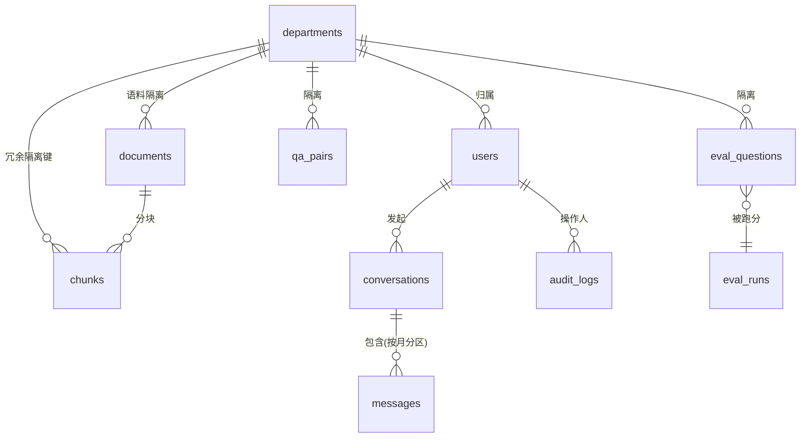

# 数据库设计 v1.0（待评审）

> 按 100x 规格设计：全部表 DDL 级到位；【MVP 建设】随试点版创建，【预留设计】到演进触发线再建（standards §25）。
> 遵循 standards §4：参数绑定、Alembic 迁移仅追加、软删、审计字段、dept 过滤强制。
> 约定：枚举一律 TEXT + CHECK（迁移友好）；JSON 键名 camelCase 由 Pydantic 映射；审计字段 `created_at/updated_at` 全表必备（下文 DDL 省略重复书写，迁移中生成）。

## 一、ER 总览



## 二、【MVP 建设】表 DDL

### 1. departments 部门

```sql
CREATE TABLE departments (
    id          BIGSERIAL PRIMARY KEY,
    code        TEXT NOT NULL UNIQUE,            -- 部门编码：service/hr/all
    name        TEXT NOT NULL,                   -- 中文名：客服/人力/全员
    is_active   BOOLEAN NOT NULL DEFAULT TRUE,
    created_at  TIMESTAMPTZ NOT NULL DEFAULT now(),
    updated_at  TIMESTAMPTZ NOT NULL DEFAULT now()
);
-- 种子：客服(service) / 人力(hr) / 全员(all)。'all' 参与 dept_id IN (...) 过滤语义。
```

### 2. users 用户

```sql
CREATE TABLE users (
    id                   BIGSERIAL PRIMARY KEY,
    username             TEXT NOT NULL UNIQUE,           -- 3-32 位字母数字
    password_hash        TEXT NOT NULL,                  -- bcrypt
    dept_id              BIGINT NOT NULL REFERENCES departments(id),
    role                 TEXT NOT NULL DEFAULT 'member' CHECK (role IN ('admin','member')),
    is_active            BOOLEAN NOT NULL DEFAULT TRUE,
    must_change_password BOOLEAN NOT NULL DEFAULT TRUE,  -- 首登强制改密
    failed_attempts      INT NOT NULL DEFAULT 0,
    locked_until         TIMESTAMPTZ,
    last_login_at        TIMESTAMPTZ,
    created_at           TIMESTAMPTZ NOT NULL DEFAULT now(),
    updated_at           TIMESTAMPTZ NOT NULL DEFAULT now()
);
CREATE INDEX idx_users_dept ON users(dept_id) WHERE is_active;
```

### 3. documents 文档

```sql
CREATE TABLE documents (
    id                BIGSERIAL PRIMARY KEY,
    title             TEXT NOT NULL,                 -- 规范命名：部门_主题_版本_日期
    dept_id           BIGINT NOT NULL REFERENCES departments(id),
    original_filename TEXT NOT NULL,                 -- 原始文件名仅存库
    file_path         TEXT NOT NULL,                 -- UUID 落盘路径（FileStorage 接口）
    mime              TEXT NOT NULL,
    size_bytes        BIGINT NOT NULL,
    content_hash      TEXT NOT NULL,                 -- SHA-256，精确查重（F-1001）
    simhash           BIGINT,                        -- 文档级近似查重（F-1002），解析后写入
    version           INT NOT NULL DEFAULT 1,    effective_date    DATE NOT NULL,                 -- 元数据必填
    expiry_date       DATE,                          -- 可选：到期自动下线（F-1004）
    owner_name        TEXT NOT NULL,                 -- 责任人必填
    status            TEXT NOT NULL DEFAULT 'pending'
                      CHECK (status IN ('pending','parsing','ready','failed')),
    parse_engine      TEXT,                          -- mineru / pypdf / python-docx / pypdf-degraded
    parse_error       TEXT,                          -- 失败原因（中文）
    is_active         BOOLEAN NOT NULL DEFAULT TRUE, -- 生效版本；新版本上传旧版置 false
    deleted_at        TIMESTAMPTZ,                   -- 软删时间（区别于版本归档：is_active=false 且 deleted_at IS NULL 为归档版本）
    uploaded_by       BIGINT NOT NULL REFERENCES users(id),
    created_at        TIMESTAMPTZ NOT NULL DEFAULT now(),
    updated_at        TIMESTAMPTZ NOT NULL DEFAULT now(),
    CONSTRAINT uq_doc_title_dept_ver UNIQUE (dept_id, title, version)
);
-- 单一生效版本数据库级强制（standards §11.6）：同部门同主题仅一个 is_active 版本
CREATE UNIQUE INDEX uq_doc_active ON documents(dept_id, title) WHERE is_active;
-- 精确查重（F-1001）：同内容仅一份；软删（deleted_at 非空）不占 hash，可重传
CREATE UNIQUE INDEX uq_doc_content_hash ON documents(content_hash) WHERE deleted_at IS NULL;
CREATE INDEX idx_documents_list ON documents(dept_id, is_active, created_at DESC);
```

### 4. chunks 向量块

```sql
CREATE TABLE chunks (
    id              BIGSERIAL PRIMARY KEY,
    document_id     BIGINT NOT NULL REFERENCES documents(id),
    dept_id         BIGINT NOT NULL REFERENCES departments(id), -- 冗余隔离键，检索免 JOIN
    title_path      TEXT NOT NULL,                 -- 标题路径前缀
    content         TEXT NOT NULL,                 -- 300-800 字
    content_chars   INT NOT NULL,
    page_no         INT,                           -- 引用定位用
    position        INT NOT NULL,                  -- 块序
    embedding       vector(1024) NOT NULL,         -- BGE-M3
    embedding_model TEXT NOT NULL DEFAULT 'bge-m3',
    hit_count       INT NOT NULL DEFAULT 0,        -- 召回统计（F-1011）：进程内聚合+N 秒批量原子累加（SET hit_count=hit_count+:n），最终一致 ≤1min
    last_hit_at     TIMESTAMPTZ,
    dup_of          BIGINT REFERENCES chunks(id) ON DELETE SET NULL,  -- 近似重复批注（F-1003）；折叠判定在查询内存态进行，此列仅异步离线标注
    is_active       BOOLEAN NOT NULL DEFAULT TRUE,
    created_at      TIMESTAMPTZ NOT NULL DEFAULT now(),
    updated_at      TIMESTAMPTZ NOT NULL DEFAULT now()
);
-- 100x 预留：向量迁移 Milvus 时本表保留 content/定位字段，embedding 列停写（standards §4.4）
CREATE INDEX idx_chunks_embedding ON chunks
    USING hnsw (embedding vector_cosine_ops) WITH (m=16, ef_construction=64)
    WHERE is_active;
CREATE INDEX idx_chunks_dept ON chunks(dept_id) WHERE is_active;
CREATE INDEX idx_chunks_doc ON chunks(document_id);
```

### 5. qa_pairs 问答对

```sql
CREATE TABLE qa_pairs (
    id              BIGSERIAL PRIMARY KEY,
    dept_id         BIGINT NOT NULL REFERENCES departments(id),
    question        TEXT NOT NULL CHECK (length(question) BETWEEN 1 AND 2000),
    answer          TEXT NOT NULL CHECK (length(answer) BETWEEN 1 AND 10000),
    embedding       vector(1024) NOT NULL,         -- 问题向量化
    embedding_model TEXT NOT NULL DEFAULT 'bge-m3', -- 模型升级重建时按此列判别（与 chunks 同规则 §13.4）
    status          TEXT NOT NULL DEFAULT 'enabled' CHECK (status IN ('enabled','disabled')),
    batch_no        TEXT,                          -- 导入批次
    created_by      BIGINT NOT NULL REFERENCES users(id),
    created_at      TIMESTAMPTZ NOT NULL DEFAULT now(),
    updated_at      TIMESTAMPTZ NOT NULL DEFAULT now()
);
CREATE INDEX idx_qa_embedding ON qa_pairs
    USING hnsw (embedding vector_cosine_ops) WHERE status = 'enabled';
CREATE INDEX idx_qa_dept ON qa_pairs(dept_id, status);
```

### 6. conversations 会话

```sql
CREATE TABLE conversations (
    id          BIGSERIAL PRIMARY KEY,
    user_id     BIGINT NOT NULL REFERENCES users(id),
    dept_id     BIGINT NOT NULL REFERENCES departments(id),
    title       TEXT NOT NULL DEFAULT '新会话',     -- 取首问截断
    is_active   BOOLEAN NOT NULL DEFAULT TRUE,     -- 软删
    created_at  TIMESTAMPTZ NOT NULL DEFAULT now(),
    updated_at  TIMESTAMPTZ NOT NULL DEFAULT now()
);
CREATE INDEX idx_conv_user ON conversations(user_id, updated_at DESC) WHERE is_active;
```

### 7. messages 消息（**100x 规格：声明式按月分区，MVP 即建成**）

```sql
CREATE SEQUENCE messages_id_seq;   -- 分区父表主键用显式 sequence 发号（PG<17 分区表不支持 identity 列）
CREATE TABLE messages (
    id                BIGINT NOT NULL DEFAULT nextval('messages_id_seq'),
    conversation_id   BIGINT NOT NULL,
    user_id           BIGINT NOT NULL,
    dept_id           BIGINT NOT NULL,
    role              TEXT NOT NULL CHECK (role IN ('user','assistant')),
    content           TEXT NOT NULL,
    citations         JSONB,                       -- [{n, refType:'doc'|'qa', refId, title, page, titlePath, score}]
    feedback          TEXT CHECK (feedback IN ('up','down') OR feedback IS NULL),
    feedback_comment  TEXT,
    feedback_category TEXT,                        -- 答案错误/引用无关/拒答不当/其他
    badcase_status    TEXT CHECK (badcase_status IN ('待处理','已修语料','已忽略')) OR badcase_status IS NULL,  -- F-702 处理状态落库
    is_eval           BOOLEAN NOT NULL DEFAULT FALSE,  -- 评测链路标记（F-5），评测记录不污染运营统计
    answer_type       TEXT CHECK (answer_type IN ('rag','qa','refuse') OR answer_type IS NULL),  -- 拒答率/命中率口径
    model             TEXT,
    prompt_tokens     INT NOT NULL DEFAULT 0,      -- F-209 成本地基
    completion_tokens INT NOT NULL DEFAULT 0,
    latency_ms        INT,
    cache_hit         BOOLEAN NOT NULL DEFAULT FALSE,
    is_active         BOOLEAN NOT NULL DEFAULT TRUE,
    created_at        TIMESTAMPTZ NOT NULL DEFAULT now(),
    updated_at        TIMESTAMPTZ NOT NULL DEFAULT now(),
    PRIMARY KEY (id, created_at),                  -- 分区键必须入主键；id 全局唯一由 sequence 保证
    CONSTRAINT fk_msg_conv FOREIGN KEY (conversation_id) REFERENCES conversations(id),
    CONSTRAINT fk_msg_user FOREIGN KEY (user_id) REFERENCES users(id),
    CONSTRAINT fk_msg_dept FOREIGN KEY (dept_id) REFERENCES departments(id)
) PARTITION BY RANGE (created_at);
-- 分区按月预建（迁移内置 ensure_month_partitions() 函数，启动与月度任务补建未来 3 个月）
-- 追加 DEFAULT 分区兜底：补建失败时写入不致全线失败，但触发告警人工处理
CREATE TABLE messages_default PARTITION OF messages DEFAULT;
CREATE TABLE messages_2026_10 PARTITION OF messages
    FOR VALUES FROM ('2026-10-01') TO ('2026-11-01');
CREATE INDEX idx_msg_conv ON messages(conversation_id, created_at);
CREATE INDEX idx_msg_dept_time ON messages(dept_id, created_at DESC);
CREATE INDEX idx_msg_feedback ON messages(dept_id, created_at DESC) WHERE feedback = 'down';
```

### 8. eval_questions 评测题 / 9. eval_runs 跑分记录

```sql
CREATE TABLE eval_questions (
    id              BIGSERIAL PRIMARY KEY,
    dept_id         BIGINT NOT NULL REFERENCES departments(id),
    question        TEXT NOT NULL,
    expected_answer TEXT NOT NULL,
    source_ref      TEXT,                          -- 期望出处（文档/问答对）
    qtype           TEXT NOT NULL DEFAULT 'factual'
                    CHECK (qtype IN ('factual','multi_hop','cross_reject')), -- 串库拒答类
    is_active       BOOLEAN NOT NULL DEFAULT TRUE,
    created_at      TIMESTAMPTZ NOT NULL DEFAULT now(),
    updated_at      TIMESTAMPTZ NOT NULL DEFAULT now()
);

CREATE TABLE eval_runs (
    id            BIGSERIAL PRIMARY KEY,
    name          TEXT NOT NULL,                   -- 如"W4 客服上线前回归"
    config        JSONB NOT NULL,                  -- {model, promptVersion, refuseThreshold, qaThreshold, efSearch} 阈值快照，防跨跑对比被污染
    status        TEXT NOT NULL DEFAULT 'running' CHECK (status IN ('running','done','failed')),  -- 崩溃后可判态
    total         INT NOT NULL,
    correct       INT NOT NULL,
    accuracy      NUMERIC(5,4) NOT NULL,
    detail        JSONB,                           -- 每题判定与引用快照
    triggered_by  BIGINT NOT NULL REFERENCES users(id),
    created_at    TIMESTAMPTZ NOT NULL DEFAULT now()
);
```

### 10. audit_logs 审计（**只增不改，无 updated_at**）

```sql
CREATE TABLE audit_logs (
    id            BIGSERIAL NOT NULL,
    actor_user_id BIGINT NOT NULL REFERENCES users(id),
    action        TEXT NOT NULL,        -- user.create / document.upload / qa.import / eval.run / ...
    object_type   TEXT NOT NULL,        -- user/document/qa_pair/eval/message
    object_id     BIGINT,
    detail        JSONB NOT NULL,       -- 前后值快照
    ip            TEXT,
    created_at    TIMESTAMPTZ NOT NULL DEFAULT now(),
    PRIMARY KEY (id, created_at)        -- 100x 按月分区的前置条件：分区键必须入主键
);
CREATE INDEX idx_audit_time ON audit_logs(created_at DESC);
CREATE INDEX idx_audit_actor ON audit_logs(actor_user_id, created_at DESC);
-- 100x 预留：量级增长后按月分区，结构已兼容（主键+时间键）
```

## 三、【预留设计】演进表（触发线到 → Alembic 追加迁移创建）

### 11. document_acl（B 阶段，F-504）

```sql
CREATE TABLE document_acl (
    id           BIGSERIAL PRIMARY KEY,
    document_id  BIGINT NOT NULL REFERENCES documents(id),
    subject_type TEXT NOT NULL CHECK (subject_type IN ('user','dept')),
    subject_id   BIGINT NOT NULL,                -- users.id 或 departments.id
    permission   TEXT NOT NULL DEFAULT 'read',
    granted_by   BIGINT NOT NULL REFERENCES users(id),
    created_at   TIMESTAMPTZ NOT NULL DEFAULT now(),
    CONSTRAINT uq_acl UNIQUE (document_id, subject_type, subject_id)
);
-- 演进后检索过滤：dept IN (...) OR EXISTS(acl 授权)；默认拒绝策略由参数控制
```

### 12. sync_sources / 13. sync_jobs（B 阶段，F-306）

```sql
CREATE TABLE sync_sources (
    id            BIGSERIAL PRIMARY KEY,
    dept_id       BIGINT NOT NULL REFERENCES departments(id),
    type          TEXT NOT NULL CHECK (type IN ('wiki','sharepoint','webdav','confluence','hr_system')),
    name          TEXT NOT NULL,
    config        JSONB NOT NULL,                -- 连接配置（敏感字段加密存储）
    cron          TEXT NOT NULL,                 -- 增量同步计划
    last_sync_at  TIMESTAMPTZ,
    is_active     BOOLEAN NOT NULL DEFAULT TRUE,
    created_at    TIMESTAMPTZ NOT NULL DEFAULT now(),
    updated_at    TIMESTAMPTZ NOT NULL DEFAULT now()
);
CREATE TABLE sync_jobs (
    id          BIGSERIAL PRIMARY KEY,
    source_id   BIGINT NOT NULL REFERENCES sync_sources(id),
    status      TEXT NOT NULL CHECK (status IN ('running','success','failed')),
    stats       JSONB,                           -- {scanned, updated, skipped, failed}
    error       TEXT,
    started_at  TIMESTAMPTZ NOT NULL DEFAULT now(),
    finished_at TIMESTAMPTZ
);
```

### 14. llm_quotas / 15. llm_usage_daily（C 阶段看板与配额，F-705）

```sql
CREATE TABLE llm_quotas (
    id                 BIGSERIAL PRIMARY KEY,
    dept_id            BIGINT NOT NULL UNIQUE REFERENCES departments(id),
    monthly_token_limit BIGINT NOT NULL,
    alert_threshold    NUMERIC(3,2) NOT NULL DEFAULT 0.80,
    updated_at         TIMESTAMPTZ NOT NULL DEFAULT now()
);
-- MVP 期 llm_usage_daily 以物化视图实现（从 messages 按日聚合，每小时刷新）：
CREATE MATERIALIZED VIEW llm_usage_daily AS
SELECT date_trunc('day', created_at)::date AS usage_date, dept_id, model,
       sum(prompt_tokens) AS prompt_tokens, sum(completion_tokens) AS completion_tokens,
       count(*) FILTER (WHERE cache_hit) AS cache_hits, count(*) AS requests
FROM messages WHERE role = 'assistant' GROUP BY 1, 2, 3;
-- C 阶段转为实体表 + 配额预检（提问前查当月用量）
```

## 四、种子数据（standards §8.10 禁止空表交付）

| 表 | 种子 |
|----|------|
| departments | 客服(service) / 人力(hr) / 全员(all) |
| users | 1 个 admin（随机初始密码，首登强制改密） |
| 问答对模板 | xlsx 模板文件随部署交付（含 3 行示例） |
| 评测题模板 | xlsx 模板文件随部署交付（含题型说明） |
| 文档黄金样本 | 解析回归样本走文件目录，不入库 |

## 五、设计与规范的对应检查

- §4.2 dept 过滤：documents/chunks/qa_pairs/conversations/messages 均含 dept_id NOT NULL ✅
- §4.4 向量规格与 HNSW 参数 ✅（迁移 Milvus 路径已注记）
- §4.5 迁移仅追加、§4.6 两段式清理（is_active → 归档 → 物理清理）✅
- §4.7 审计覆盖管理动作 ✅（audit_logs + F-801 清单）
- 100x 预留：messages 分区已建成、ACL/同步/配额表 DDL 到位待触发 ✅
- M10 治理字段：documents.content_hash（唯一索引）/ simhash / expiry_date，chunks.hit_count / last_hit_at / dup_of ✅
