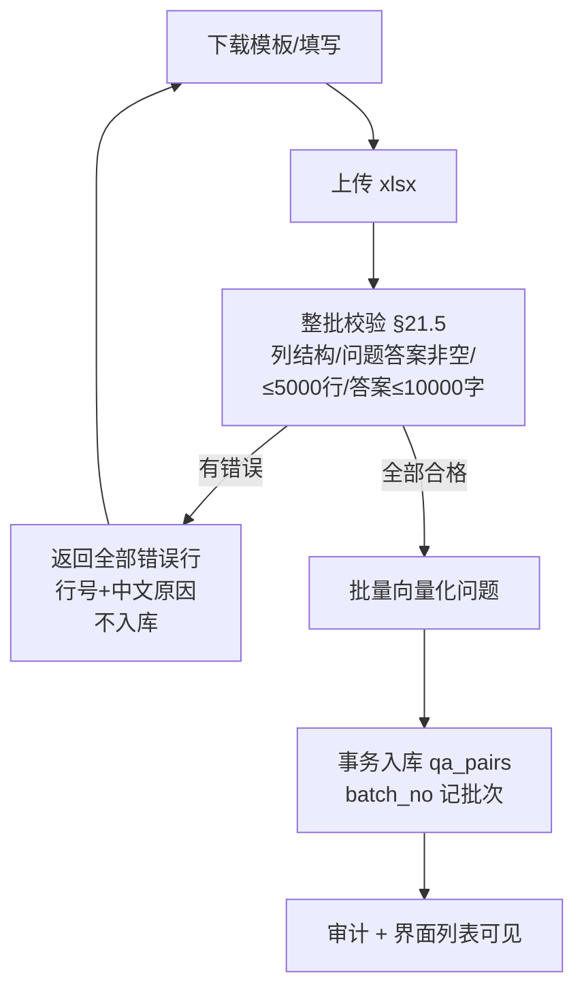
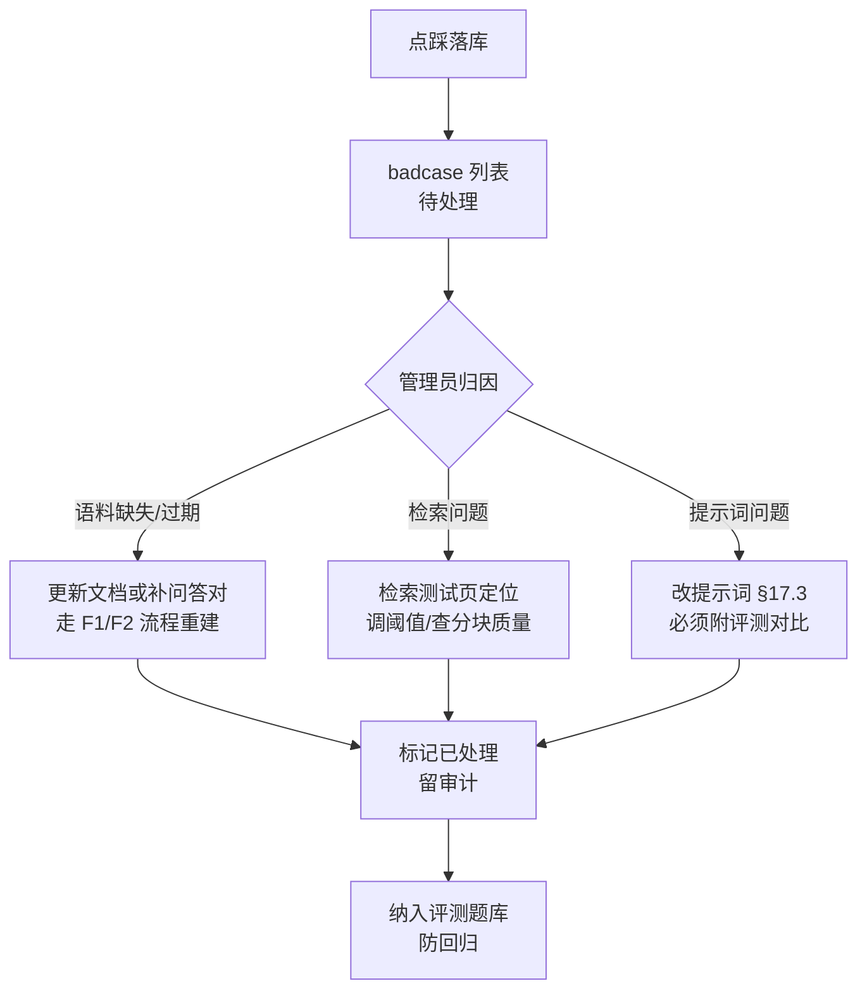
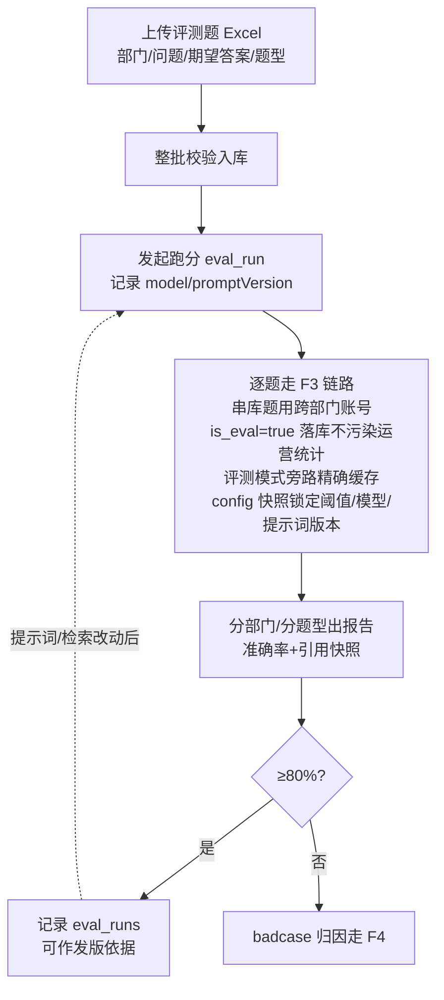
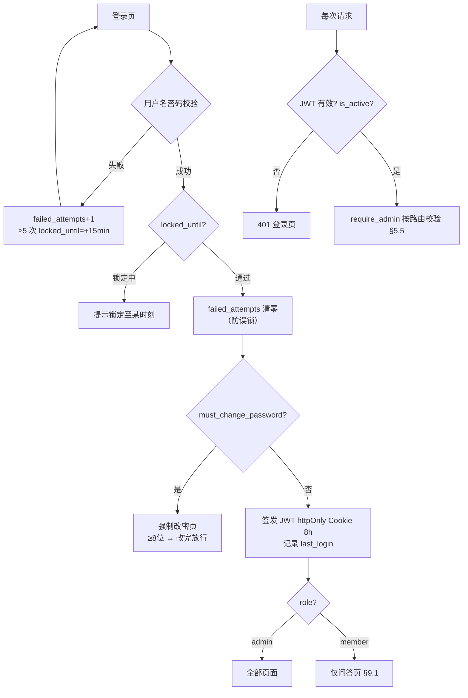
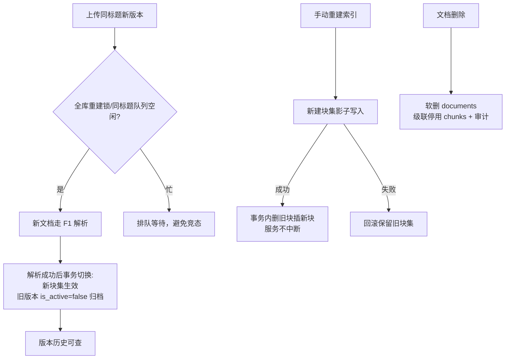
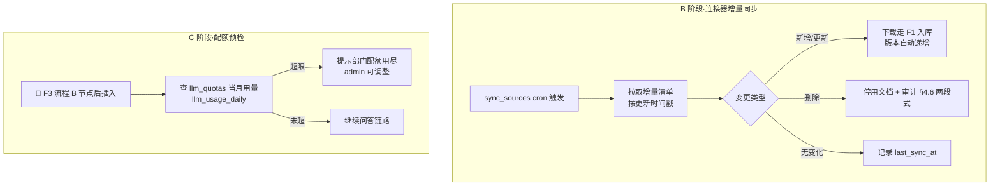

# 操作流程图 v1.0（待评审）

> mermaid 流程图，评审通过后作为实现与测试用例的依据。标 🔶 的节点为 100x 预留插入点（MVP 不实现，位置已在设计中固定）。
> 流程中规则编号（如 §21.5）指向 standards.md。

## F1 文档入库流程（F-301/302/304）

```mermaid
flowchart TD
    A[管理员上传文档] --> A0{同步预检·毫秒级<br/>①三重白名单 §6.3<br/>②SHA-256 精确查重 F-1001}
    A0 -- 白名单不符/.doc/超限 --> A1[拒绝并提示原因]
    A0 -- 完全重复 --> A1b[秒拒并指向已有文档]
    A0 -- 通过 --> A2[元数据表单（自动建议预填 F-1008：<br/>部门限枚举+日期白名单+责任人=上传人兜底）<br/>合规确认勾选 §7.4]
    A2 -- 缺填/未勾 --> A3[不可提交]
    A2 -- 提交 --> D[UUID 落盘 FileStorage<br/>status=parsing 写审计<br/>zip 批量：拆分后逐条目重过 A0<br/>嵌套 zip 拒收]
    D --> E{文件类型}
    E -- docx --> F1a[python-docx 进程内解析]
    E -- pdf --> F1b[MinerU 服务<br/>版面/表格/OCR]
    F1b -- 失败重试1次仍败 --> F1c[降级 pypdf 纯文本<br/>标注'降级解析']
    F1a --> H0{质量红线 §10.3<br/>有效字符 < max(100, 原始×10%)<br/>原始字符=清洗前全文}
    F1b --> H0
    F1c --> H0
    H0 -- 不达 --> G5[status=failed<br/>中文原因可重试]
    H0 -- 通过 --> H[清洗 rag/clean.py<br/>页眉页脚/目录/水印]
    H --> G2{解析后异步预检 §10.8 二段<br/>③乱码率检测 F-1005<br/>④敏感信息扫描 F-1006<br/>（含 OCR 识别文本）<br/>⑤simhash 近似查重 F-1002}
    G2 -- 乱码率超限 --> G5
    G2 -- 敏感命中 --> G3[状态=待确认：脱敏入库或拒收<br/>脱敏=文本层打码后重跑④<br/>原文件归档受限访问]
    G2 -- 近似重复 --> G4[入库但 is_active=false<br/>列表标'待确认'，确认后激活]
    G2 -- 通过 --> J[按标题层级语义分块<br/>300-800字 + title_path 前缀]
    G3 -- 确认脱敏入库 --> J
    G4 -- 管理员确认 --> J
    J --> K[批量向量化 TEI-embed<br/>BGE-M3 1024维]
    K --> L[事务写入 chunks<br/>同标题旧版本 is_active=false]
    L --> M[status=ready]
    G5 --> N[界面显示失败原因+重试]
    N -.重试.-> E
```

## F2 问答对 Excel 导入（F-401）



## F3 问答主流程（F-201~205, 501/502）—— 核心

```mermaid
flowchart TD
    A[用户提问 1-2000字 §21.5] --> B[鉴权 + 部门解析]
    B --> C[规范化问题<br/>去首尾空白/去标点差异]
    C --> D{精确缓存 §17.5<br/>TTL 5min 部门+规范化问题<br/>（多轮用改写后问题作键）}
    D -- 命中 --> E[直接返回<br/>标注'来自缓存']
    D -- 未命中 --> F{多轮? 带最近3轮<br/>LLM 改写独立问题}
    F --> G[🔶 语义缓存查询 ·A阶段]
    G --> H[问答对语义匹配<br/>dept_id IN 用户部门,全员 §4.2<br/>且 status='enabled'（停用不命中）<br/>query 向量一次计算复用]
    H -- 最高分 ≥0.85（余弦相似度口径 §4.4）--> I[整条问答对注入<br/>引用类型=qa_pair]
    H -- 未达阈值 --> J[向量检索 top20<br/>chunks WHERE is_active + dept 过滤<br/>复用同一 query 向量]
    J --> K[🔶 ACL 过滤插入点 ·B阶段<br/>dept IN 演进为 ACL 判定]
    K --> L[rerank top20→top5<br/>bge-reranker-v2-m3<br/>分数=sigmoid(logit) 口径 §4.4]
    L --> L2[近似重复块折叠 F-1003<br/>embedding 相似度 ≥0.98 只留最高分]
    L2 --> M0{检索结果为空?}
    M0 -- 是 --> N[拒答:'知识库中未找到相关内容'<br/>不编造 §16.3]
    M0 -- 否 --> M{top1 rerank 分数<br/>< 拒答阈值?<br/>初始 0.55 可配（P5 界面调）}
    M -- 是 --> N
    M -- 否 --> O[组装 prompt §17<br/>system 三原则<br/>资料包裹 data 标签<br/>引用编号程序生成]
    I --> O
    O --> P[SSE 流式生成 §3.6<br/>max_tokens clamp §17.5<br/>用户问题仅 user role<br/>多轮改写失败→降级原问题]
    P --> Q[event: citations<br/>先于 token 下发（§3.6 DTO）]
    P --> R[event: token 逐字]
    PX[生成异常/断流<br/>event: error{code,retryable}<br/>前端提示可重试；重试=新消息<br/>中断消息标记失败不重复落库]
    P --> PX
    P --> S[event: done<br/>refused/cacheHit/tokens 落库+下发<br/>is_eval=评测链路标记（F-5）]
    S --> T[更新会话标题/时间]
    N --> S
    E --> S
    S --> U{用户反馈}
    U -- 点赞 --> V[feedback=up]
    U -- 点踩 --> W[必选分类+备注 §F-208<br/>进入 badcase]
```

## F4 badcase 治理闭环（F-702）



## F5 评测流程（F-601~603）



## F6 鉴权流程（F-101/102）



## F7 文档更新/重建索引（F-303/304, §11）



## F8 100x 预留流程（设计到位，按触发线启用）



## 流程与包件一致性

- F1/F2/F7 的状态与状态机 ↔ db-design documents.status、qa_pairs、版本字段 ✅
- F3 的过滤与阈值 ↔ features F-502/F-204、standards §17 ✅
- F6 与 standards §5 鉴权规范逐条对应 ✅
- 🔶 节点即 scaling-plan 触发线的代码插入点，评审时确认位置 ✅
